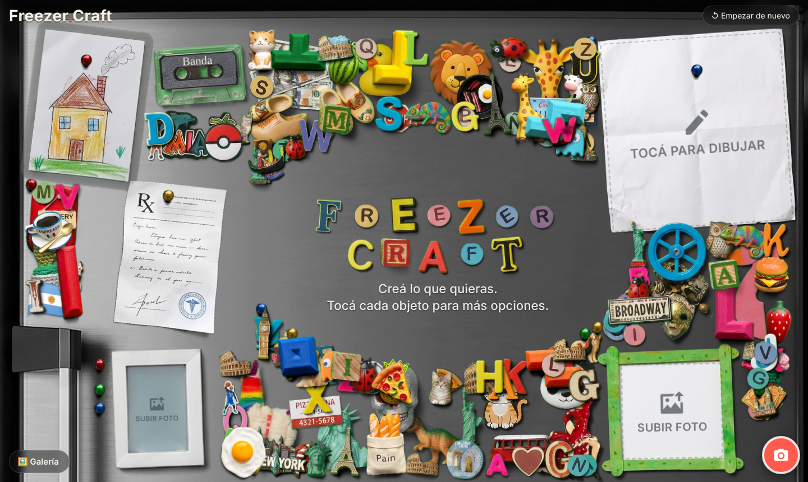

# Freezer.Craft 🧲

Decorá una heladera con imanes. Arrastrá, acomodá, girá, pegá papeles y poné tus propias fotos en los portarretratos.



## Cómo se juega

Se juega en horizontal. En un celular en vertical el juego aparece girado, con un aviso para que gires el teléfono.

Al entrar, **todos los imanes ya están pegados** alrededor de la heladera, con **FREEZER CRAFT** escrito en el medio con letras imán y una breve explicación debajo.

- **Mover:** arrastrá cualquier imán; se pega donde lo soltás. La manija va por encima: podés meter imanes por debajo.
- **Opciones:** tocá un objeto y aparecen **Rotar**, **Poner por arriba**, **Poner por debajo** y **Eliminar** (con *Deshacer*). Según el objeto, también **Poner foto**, **Dibujar**, **Escribir** o **Cambiar bandera**.
- **Seleccionar varios (compu):** mantené **Shift** y arrastrá sobre la heladera para marcar un área, o hacé Shift + clic en cada objeto. Después se mueven y se editan todos juntos.
- **Papeles:** la receta, el dibujo y la hoja en blanco solo se sostienen con un imán encima (por ejemplo, una bolita). Si se lo sacás, se resbalan.
- **Hoja en blanco:** tocala para dibujar, con colores, grosores, goma y deshacer.
- **Portarretratos:** muestran "Subir foto". Tocalos y elegí una foto de tu compu o de tu teléfono.
- **Cassette:** dice "Banda"; tocalo → **Escribir** para poner el nombre de una banda o canción.
- **Bandera:** tocala para elegir la bandera de cualquier país.
- **Zoom:** pellizcá con dos dedos o usá la rueda del mouse.
- **Teclado:** `Supr` elimina, `Ctrl/Cmd + Z` deshace, `R` gira, las flechas mueven, `Esc` deselecciona.
- **📷 Cámara (abajo a la derecha):** saca una foto de tu heladera; le ponés nombre y la descargás o la subís a la galería.
- **🖼️ Galería (abajo a la izquierda):** las heladeras de todos.
- **↺ Empezar de nuevo:** vuelve todo al acomodo inicial (incluidos los objetos eliminados).
- **Música:** suena bajita de fondo desde el primer toque (los navegadores no permiten que arranque antes).

Lo que armás se guarda solo en el navegador (`localStorage`), incluidas fotos y dibujos.

## La galería

Sin configurar nada, la galería guarda las fotos **en el dispositivo** de cada persona.

Para que la galería sea **mundial** (todos ven las heladeras de todos) se usa Supabase, que es gratis. GitHub Pages solo sirve archivos: no puede guardar las fotos que sube la gente, por eso hace falta este paso:

1. Creá un proyecto en [supabase.com](https://supabase.com).
2. En **Storage**, creá un bucket **público** llamado `galeria`.
3. En **SQL Editor**, corré esto para permitir ver y subir fotos (pero no borrarlas):

```sql
create policy "galeria: ver" on storage.objects
  for select to anon using (bucket_id = 'galeria');
create policy "galeria: subir" on storage.objects
  for insert to anon with check (bucket_id = 'galeria');
```

4. En **Project Settings → API** copiá la *Project URL* y la clave *anon public* y pegalas en `js/config.js`.

La clave *anon* es pública a propósito. Ojo: cualquiera que use el juego puede subir fotos con el nombre que quiera, y no hay moderación; para borrar una, entrá a Storage en Supabase. El nombre de cada foto se guarda dentro del nombre del archivo.

## Publicarlo en GitHub Pages

1. Creá un repositorio (por ejemplo `freezer-craft`) y subí todo el contenido de esta carpeta.
2. En el repo, andá a **Settings → Pages**, elegí **Deploy from a branch**, rama `main`, carpeta `/ (root)` y guardá.
3. En uno o dos minutos queda online en `https://TU-USUARIO.github.io/freezer-craft/`.

No necesita compilar nada: es HTML, CSS y JavaScript sin dependencias.

## Probarlo en tu compu

Abrí `index.html` directamente, o mejor levantá un servidorcito (así funcionan bien la cámara y la galería):

```bash
cd freezer-craft
python3 -m http.server 8000
# y abrí http://localhost:8000
```

## Estructura

```
index.html          página del juego
css/style.css       estilos
js/game.js          lógica: acomodo inicial, arrastre, reglas de pegado, papeles, fotos, cámara
js/gallery.js       galería (en el dispositivo o compartida con Supabase)
js/config.js        datos de Supabase para la galería compartida
js/magnets.js       lista de imanes (tamaño, categoría y tipo de cada uno)
assets/fridge.jpg   fondo: la puerta de metal
assets/handle.png   la manija recortada (va por encima de los imanes)
assets/music.mp3    música de fondo
assets/magnets/     un PNG transparente por imán
```

### Agregar imanes nuevos

1. Poné un PNG con fondo transparente (y su sombra) en `assets/magnets/`, por ejemplo `mi-iman.png`.
2. Sumalo a `js/magnets.js`:

```js
{"id":"mi-iman","w":120,"h":90,"cat":"juguetes","type":"magnet"}
```

- `w` y `h`: tamaño en la heladera (una letra mide unos 55 de alto). Conviene que el PNG tenga el doble de píxeles, para que se vea nítido.
- `type`: `magnet` (imán), `paper` (necesita un imán encima), `frame` (portarretratos) o `flag` (bandera).
- Extras opcionales, en proporciones de 0 a 1 de la imagen: `"win":[x,y,ancho,alto]` (ventana de la foto de un portarretratos), `"draw":[…]` (zona para dibujar), `"label":[…]` y `"text":"Banda"` (texto editable).
- `img`: usar el PNG de otro nombre (así las bolitas de un color comparten imagen).

### Cambiar el fondo o la música

El fondo está definido al principio de `js/game.js`, en `BG`: la imagen, la chapa donde pegan los imanes (`doors`), la manija (`handles`) y su recorte que va por encima (`overlay`), en píxeles de la imagen. `WORLD` controla el tamaño de los imanes (más chico = más grandes). La música es `assets/music.mp3` y su volumen, `MUSIC_VOLUME`.

## Créditos y derechos

- Las banderas en Windows usan [Twemoji](https://github.com/jdecked/twemoji) (licencia CC-BY 4.0); en Mac, iPhone y Android se usa el emoji del sistema.
- Antes de publicar, asegurate de tener derecho a usar la música y las imágenes (algunos imanes muestran personajes o marcas de terceros).
